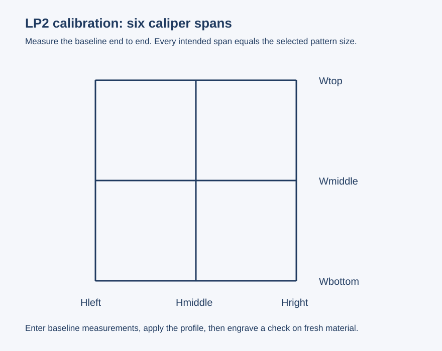

# Calibrate dimensions with calipers

Calibration corrects independent X/Y scale and symmetric inward/outward edge bow.
It runs on the PC above the LP2's stock mapping. It does not change firmware or
the factory calibration table.

## Measure, apply, verify

1. Establish the working focus and head height. Keep them unchanged for the
   baseline, check, and subsequent jobs. Connect the bridge and wait for Idle.
2. Open **Calibration**. Choose a target size from **20–80 mm**; the initial value
   is **80 mm**. The GUI starts at **5% / 50 mm/s** for this outline pattern.
   Adjust to produce a fine visible mark on suitable scrap; these are not
   universal material settings.
3. Click **1. Engrave baseline**. The baseline deliberately bypasses PC calibration,
   including a previously selected profile, while retaining normal orientation.
4. Measure between line centers along all six spans. Every intended span equals
   the selected target size. Enter actual millimeters in the matching fields:

   | Field | Measure |
   | --- | --- |
   | `Wtop` | Width along the top line |
   | `Wmiddle` | Width along the horizontal centerline |
   | `Wbottom` | Width along the bottom line |
   | `Hleft` | Height along the left line |
   | `Hmiddle` | Height along the vertical centerline |
   | `Hright` | Height along the right line |

5. Click **2. Calculate correction**. Review the draft and any asymmetry warning.
   Differences above 0.5 mm between opposite spans trigger a warning.
6. Click **Save profile** to keep a reusable JSON file, then **3. Apply profile**
   while idle. The GUI remembers the selected profile.
7. On fresh material at the same height, click **4. Engrave check**. Measure again.
   The physical check establishes accuracy; the preview only shows the model.

Use the original baseline measurements to calculate the profile. Do not enter the
corrected check as though it were an uncorrected baseline. **Disable correction**
restores the PC's uncalibrated path. **Load profile** opens a saved JSON profile.

## Practical limits

- Avoid applying another dimensional correction by rescaling the artwork at the
  same time. That would apply the correction twice.
- Corrected marking geometry must fit the 100 × 100 mm command field. Use a
  smaller pattern or artwork if preflight reports out-of-bounds geometry.
- Strong asymmetry, skew, tilt, off-center distortion, or a focus change may need
  a different model or additional measurements.
- Vectors and images share the measured mapping. Vector quantization and bitmap
  resampling limit precision and can affect isolated dots or fine dither texture.
- Check power and speed again after geometry changes.

Calibration patterns are real laser jobs. They own the device while running and
cannot interleave with LightBurn jobs. No pattern starts automatically on opening
the application. Profiles, preferences, and captures live in `LP2BridgeData` beside
the EXE (or beside the project when running the GUI from source).
